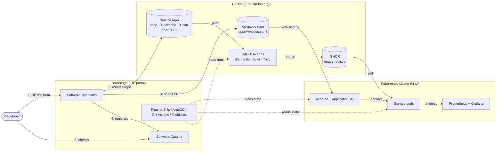
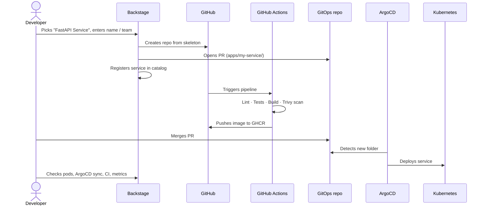

# Architecture

## Overview

## Golden path

**Target:** under 5 minutes from click to running service.

## Key design decisions

| Decision | Why |
|---|---|
| Dedicated GitHub org | Generated repos stay isolated from personal profile |
| GitOps with ArgoCD ApplicationSet | Every `apps/<service>/` folder becomes an Application — no manual config per service |
| Helm chart lives in the service repo, values in `idp-gitops` | Service owns its packaging; platform owns environment config |
| Secrets in environment variables only | Nothing sensitive ever committed |
| Backstage reads ArgoCD through its backend proxy, with a read-only local account | The token never reaches the browser; Backstage can see deployments but never sync or delete them |
| Read-only Kubernetes ServiceAccount for Backstage (no Secrets) | Developers see their pods without cluster credentials; least privilege |
| Each service's Helm chart ships its own `ServiceMonitor` | Monitoring is self-service: no central list of Prometheus targets to maintain |
| One generic Grafana dashboard, generated from code | New services appear in the dashboard automatically; changes are reviewed in Git |
